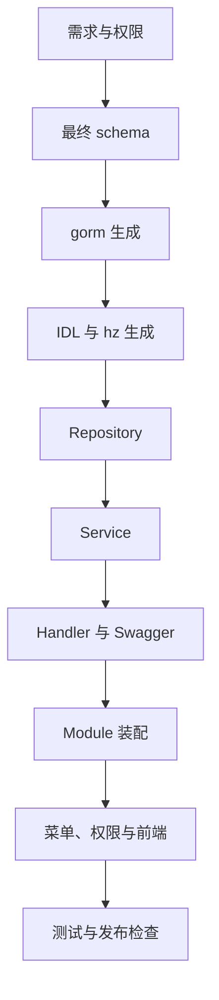

gosilite 用 Module 插件承载业务域。新增模块必须遵守 `main → application → Module → router → handler → service → repository → infra` 的单向依赖，不要把业务路由写进前端静态路由表，也不要直接修改生成文件。

## 标准步骤

1. **定义边界。** 明确路由、DTO、错误码、权限码、菜单、数据表和验收条件；复杂功能先写 `docs/compose/spec/<feature>.md`。
2. **更新最终 schema。** v0.1.0 仅使用 `script/schema/v0.1.0.sql`。新增表或种子时先在该文件中修改，再在空 PostgreSQL 16 数据库执行 `./script/init-schema.sh` 验证。不要重新引入历史 `migrations/` 目录。
3. **生成数据访问代码。** 用空库初始化后的 DSN 设置 `GOSILITE_CODEGEN_DSN`，执行 `go run ./script/codegen`；`*.gen.go`、`application/**/dal/query` 不可手改。
4. **定义 HTTP 契约。** 新增或修改 `idl/<domain>/<feature>.thrift`，再执行 `hz update -I idl -idl <file> -customize_package idl/package.yaml`。`api/model` 和路由 `Register` 是生成物。
5. **实现后端分层。** Repository 只负责数据访问；Service 负责业务规则并返回 `errorx` 错误；Handler 只绑定、校验、调用 Service、经 `R.*` 返回。DTO/VO 转换放在 `convert.go`。每个对外 Handler 写完整 Swagger 注解。
6. **装配业务域。** 新建 `application/<domain>/module.go`，实现 `Name`、`Init`、`RegisterRoutes`，并登记到 `application/application.go` 的 `builtinModules()`。业务模块不得调用 `Spin()`。
7. **接入权限与前端。** 通过最终 schema 的 `system_menu` 和角色关联写入页面、按钮权限；页面置于 `web/src/pages/`，`defineOptions({ name })` 必须匹配完整动态路由名。业务菜单由 `GET /menu/routes` 提供，不在 `web/src/router/modules` 新增静态业务路由。
8. **验收。** 先运行相关 Go 单测，再执行 `WEB=1 ./script/check.sh`；页面改动还应以测试账号完成实际浏览器烟测。

## 固定约束

- 标量 i64 HTTP 标识在 IDL 使用 `json:"field,string"`；数组使用 `list<string>`，前端以 `string` / `string[]` 传递。
- 新列表默认分页；管理接口默认挂权限中间件。
- `t-*` 组件先通过 TDesign MCP 查询文档；通用 UI 第三次复用时抽取 `s-*` 组件。
- 业务失败使用 `errorx.New` 或 `errorx.WrapByCode`，由 `R.Error` 统一回包与记录可定位的错误日志堆栈。
- 正式提交前不要改写 `main` 历史；通过 PR、CI 和代码审阅交付。
